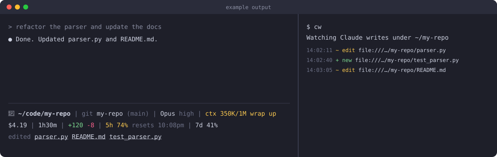

# ghostty-claude-config

A status line and a live file feed for running Claude Code in the Ghostty terminal (they work in most other terminals too).



## What you get

**Status line** (three lines under the Claude Code prompt):

```
📂 ~/code/my-repo | git my-repo (main) | Opus high | ctx 350K/1M wrap up
$4.19 | 1h30m | +120 -8 | 5h 74% resets 10:08pm | 7d 41% | cache warm 1h
edited  parser.py  README.md  +3 more
```

- The full path of the folder Claude is working in, never shortened. Cmd+click it to open the folder in Finder. Change folders with Claude Code's built-in `/cd <folder>`.
- Context shown in absolute tokens, yellow with "wrap up" at 300K and red with "handoff now" at 500K (set `CTX_WARN_TOKENS` / `CTX_STOP_TOKENS` to change).
- Session cost, elapsed time, lines changed, 5-hour and 7-day usage limits (yellow at 70%, red at 90%), prompt cache warm or cold.
- Files this session created or edited. Cmd+click a name to open it in VS Code.

**Live write feed** (`cw`): run it in a split pane to watch every file Claude creates or edits, each as a clickable `file://` link.

```
14:02:11 + new  file:///path/to/project/notes.md
14:02:40 ~ edit file:///path/to/project/src/app.py
```

## Requirements

- Claude Code, `jq`, `bash`
- VS Code (optional, for opening files from the status line)

## Install

```bash
git clone https://github.com/<you>/ghostty-claude-config.git ~/ghostty-claude-config
chmod +x ~/ghostty-claude-config/scripts/*.sh ~/ghostty-claude-config/hooks/*.sh
```

Add to `~/.claude/settings.json` (merge with any existing `hooks` block):

```json
{
  "statusLine": {
    "type": "command",
    "command": "bash ~/ghostty-claude-config/scripts/statusline.sh"
  },
  "hooks": {
    "PostToolUse": [
      {
        "matcher": "Edit|Write|NotebookEdit",
        "hooks": [
          { "type": "command", "command": "bash ~/ghostty-claude-config/hooks/log-file-writes.sh" }
        ]
      }
    ]
  }
}
```

Add to `~/.zshrc`:

```bash
# Live feed of files Claude writes in the current folder
alias cw='~/ghostty-claude-config/scripts/watch-writes.sh .'

# Make bypass-permissions mode available in the Shift+Tab cycle (does not start in it)
alias claude='claude --allow-dangerously-skip-permissions'
```

Then `source ~/.zshrc`.

## Use

- Start `claude`; the status line appears after the first reply.
- Press Cmd+D in Ghostty for a split, `cd` to the project, run `cw`.
- Shift+Tab cycles permission modes, now including bypass. Bypass skips all permission checks, so use it only in folders you can restore.

## Notes on clickable links in Ghostty

- Inside the Claude Code status line, OSC 8 hidden links work, so file names open in VS Code via `vscode://file/...`.
- In ordinary shell output, Ghostty ignored OSC 8 links in testing, but it opens visible `https://` and `file://` URLs on Cmd+click. That is why the feed prints full `file://` URLs. A `file://` link opens in the default app for that file type; to use VS Code, select a file of that type in Finder, press Cmd+I, set "Open with" to VS Code and click "Change All".
- Spaces and `%`, `#`, `?` in paths are percent-encoded so links stay whole.

## License

MIT
